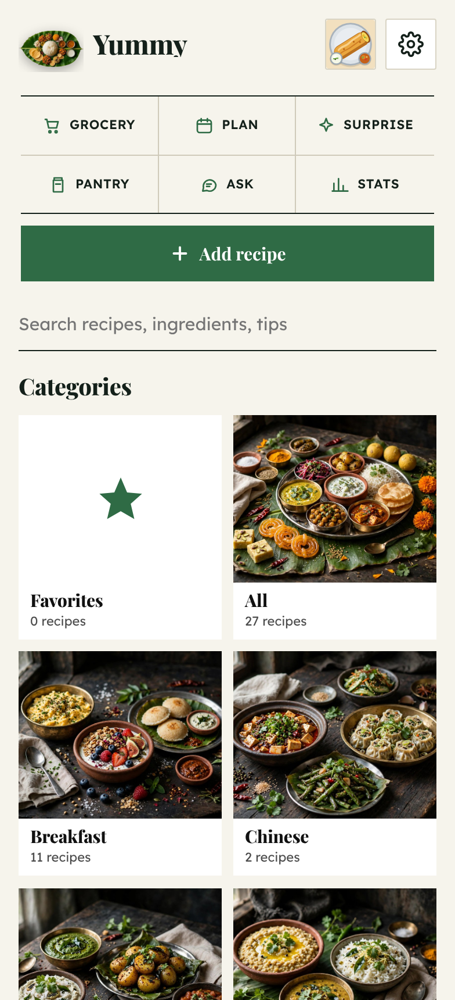
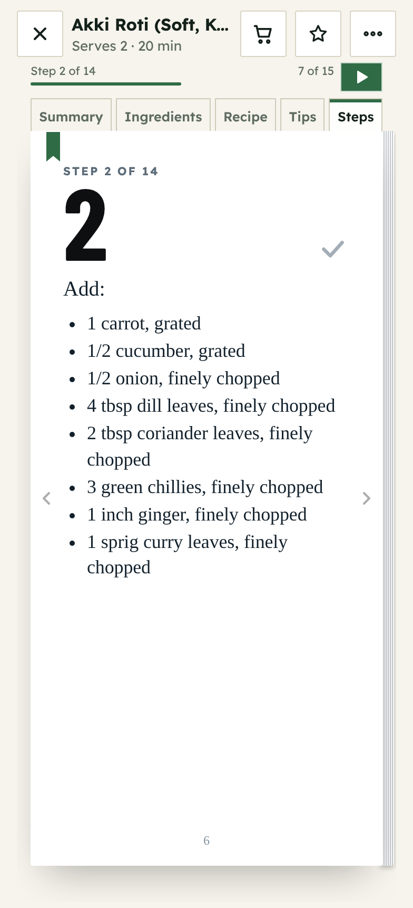
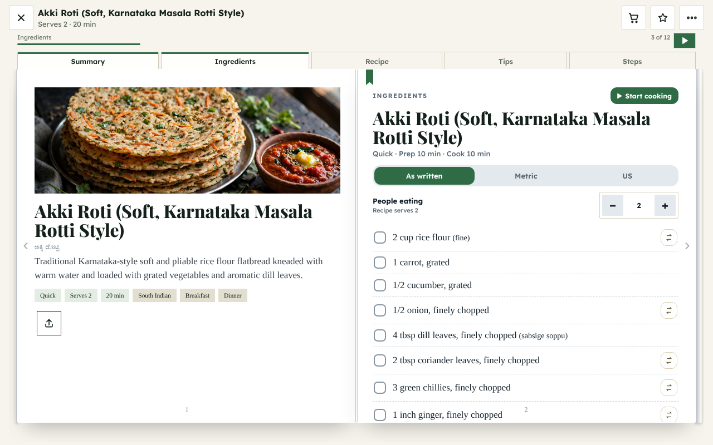

# Yummy


A personal recipe book that runs entirely on the phone or tablet. Recipes are pasted in as text, read like a book with page turns, scaled to the number of people eating, and can be read aloud. There are no accounts and no server.

Download the latest APK from the [releases page](https://github.com/AbhishekSrinivas/Yummy-App/releases/latest).

| Home | Steps | Tablet landscape |
|---|---|---|
|  |  |  |

## What it does

- 27 bundled South Indian and other vegetarian recipes with photos, categories and time groups (Instant, Quick, Normal)
- Add recipes by pasting text or importing a zip with images; titles can be reviewed on import
- Book reader with page turns, a two-page spread in landscape, step ticks and timers
- People-eating stepper that scales ingredient amounts and the quantities written inside the steps
- Metric and US units, ingredient swaps, grocery list, weekly plan, pantry and cooking stats
- Read aloud with highlighting, speed options and a choice of ingredients only or the whole recipe
- Favorites, search across recipes, ingredients and tips, and A-Z or custom ordering
- Editorial theme with light, dark and true black modes
- Full-resolution photos and bundled fonts, so everything works offline
- Installed app checks for updates every 3 days and asks before updating (see below)

## Install

On Android, open the latest release, download `Yummy.apk`, and allow installs from your browser or file manager when asked. The APK is rebuilt on every push to `main`. It is debug-signed, so installing a new one over the old one keeps your data.

You can also build `www` and serve it from any static host.

## Updates without a new APK

The installed app looks at the latest release for `version.json` at most once every 3 days when it opens, and any time from Settings, App updates. If the build number is newer, it shows a prompt. Tapping Update downloads `app.html`, keeps it on the phone, and asks for a restart. Later closes the prompt until the next check.

- Needs internet and a repository that can be read without signing in (public). On a private repo the check quietly finds nothing and the APK is the only way to update.
- Updates change the app code and bundled recipes. New or changed photo files are only in the APK, so those need a new APK install.

## Build

Needs Python 3 and Node 18+.

```bash
python3 src/build.py          # writes www/
npm install
npx cap add android           # first time only
npx @capacitor/assets generate --android --iconBackgroundColor '#0F6E6E'
npx cap sync android
cd android && ./gradlew assembleDebug
```

The APK ends up in `android/app/build/outputs/apk/debug/`. Pushing to `main` or running the **Build Android APK** workflow does the same thing on GitHub.

## Layout

```
src/index.src.html   app source, a single readable file
src/images/          full-size photos (1920 px), images/m has smaller copies for lists
src/fonts/           bundled Lexend, Playfair Display and Barlow Condensed
src/build.py         writes www/ (launcher, app.html, img, version.json)
assets/              app icon
docs/screenshots/    images used in this README
.github/workflows/   APK build and release
capacitor.config.json  Android wrapper settings
```

## Editing

Change `src/index.src.html` and push. The workflow builds `www/` itself. The bundled recipes are the `DEFAULTS` list in the source. Existing installs pick up changed bundled recipes without losing photos or notes.

## Signing

Android only installs an APK over an older one when both are signed with the same key. The first build creates a debug key and the workflow keeps it in the Actions cache, so every later build reuses it and installs over the last one with your data kept. If GitHub clears the cache after a long idle period, the next build gets a new key and you have to uninstall the old app first, so back up from Settings before that.
